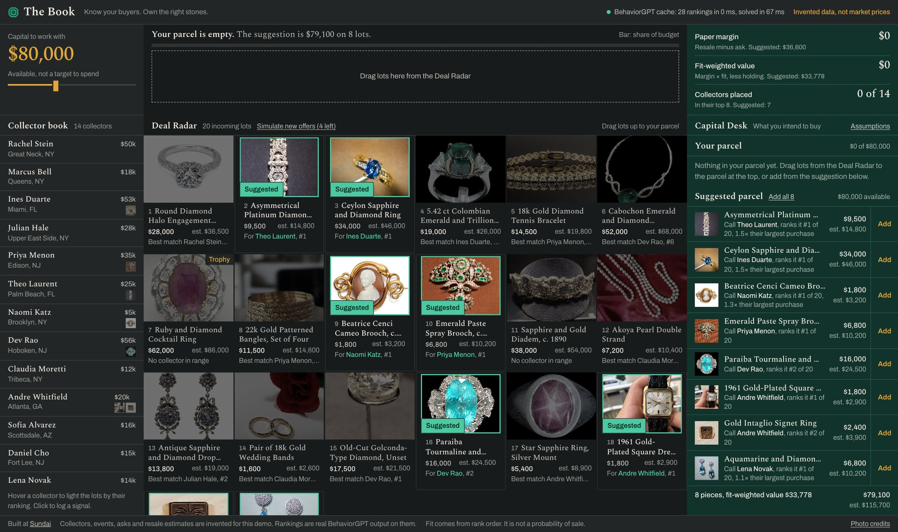
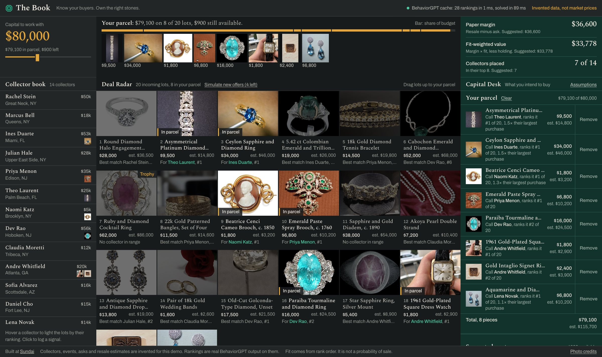
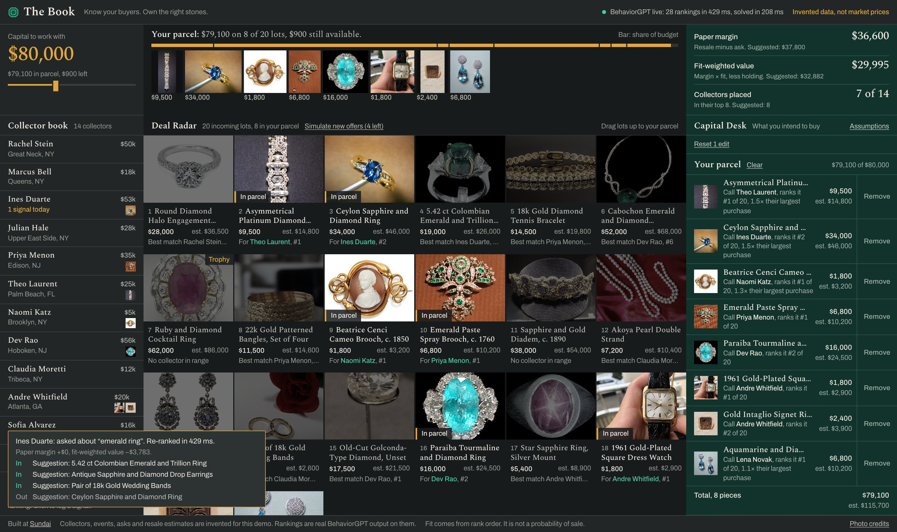
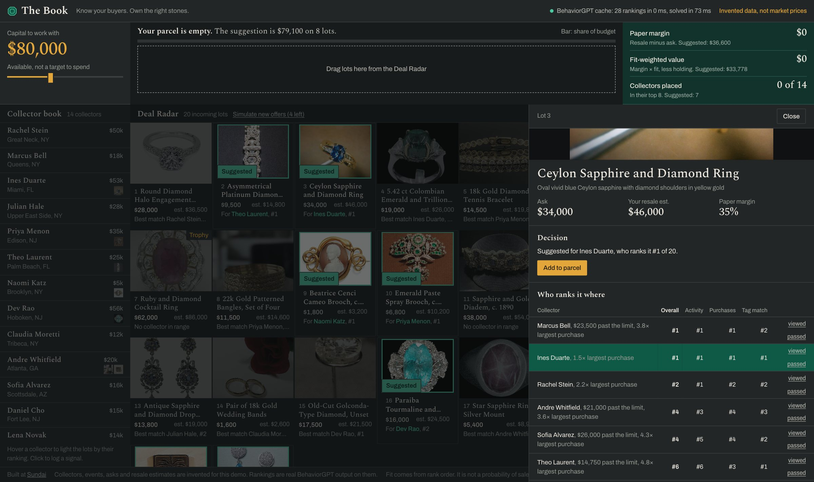

# The Book

**Know your buyers. Own the right stones.**

Built for [Sundai](https://www.sundai.club/) Hack 148.

An acquisition terminal for independent estate-jewelry dealers. A dealer with $80,000 to spend builds a parcel from incoming lots, sees which collector each piece is for, and compares their choices against an optimized suggestion. The dealer makes the decision.



> **All data is simulated.** Collectors, histories, asks and resale estimates are invented, and the app says so. The rankings are real BehaviorGPT output on those histories. Fit comes from rank order and is not a probability of sale.

## How it works

1. **Rank.** [BehaviorGPT](https://github.com/Unbox-AI/behaviorgpt) reads what each collector did, in order, and ranks the lots for them twice: on everything they did, and on only what they bought. It reads each piece from its photo and text, with no tagging.
2. **Compare.** We blend the two rankings, then favor lots a collector likes more than the rest of the book does. That gives each collector their own overall rank.
3. **Score.** Each lot's margin (resale estimate minus ask) is discounted by how well it fits the collector. A #1 keeps its full margin, a #2 counts for about 78%, and weaker matches also take a small holding charge.
4. **Solve.** A mixed-integer program (SciPy HiGHS) picks lots and buyers together for the highest total score, within the dealer's capital, each collector's capacity and a limit of two pieces per collector. A lot two collectors want can only go to one of them.
5. **Decide.** Every summary number comes from the dealer's own parcel. The solver's plan sits beside it, scored by the same rules, and suggests what to add with the capital left.

## In the app

**Build a parcel and get a call list.** Drag lots up, or take the suggestion, to see each piece's buyer and rank.



**Log a phone call and re-rank live.** One new event updates that collector's ranking, the parcel's score and the suggestion.



**See who ranks a lot where.** Compare each collector's overall, activity and purchase ranks with simple tag matching.



## What we found

- BehaviorGPT does not beat tag matching in our test: a hidden purchase ranked 3.8 of 20 against 3.1 for tags, with random at 10.5. The test favors tags, because the histories were simulated from tags. What BehaviorGPT does differently is read new pieces with no tagging and follow the order of events.
- The fit-weighted value is a way to compare choices under this tool's assumptions. It is not a forecast of profit, and nothing here shows the tool would make a dealer money.
- Past purchases push rankings toward more of the same. The model never concludes that someone already has enough.

## Run it

Get a free key at [portal.unboxai.com](https://portal.unboxai.com), then put `UNBOXAI_API_KEY` and `UNBOXAI_CATALOG_ID` in `.env`.

```bash
uv sync
uv run python scripts/build_book.py
uv run python scripts/embed_catalog.py
uv run uvicorn server.app:app --reload
```

In a second terminal:

```bash
cd web && npm install && npm run dev
```

## Credits

Lot photos are stand-ins under open licenses, credited in [CREDITS.md](CREDITS.md) and in the app. Lot names, asks and resale figures are invented and say nothing about the pictured objects or their owners.

Built at [Sundai](https://www.sundai.club/) for Sundai Hack 148.
